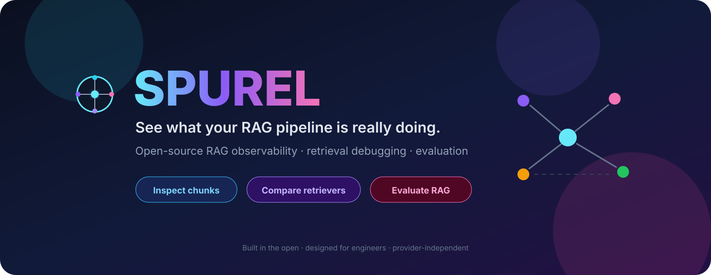
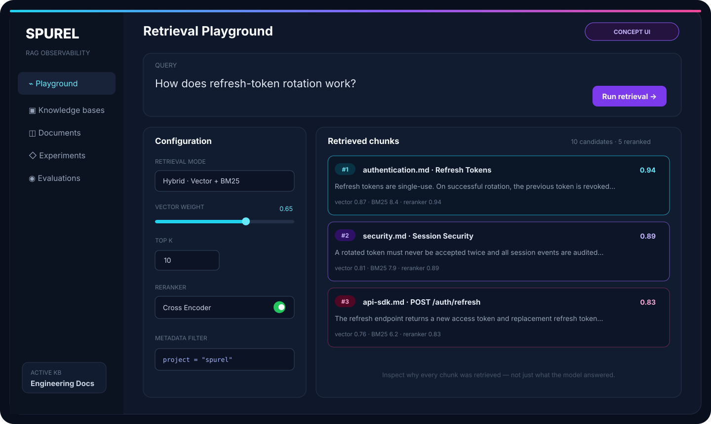
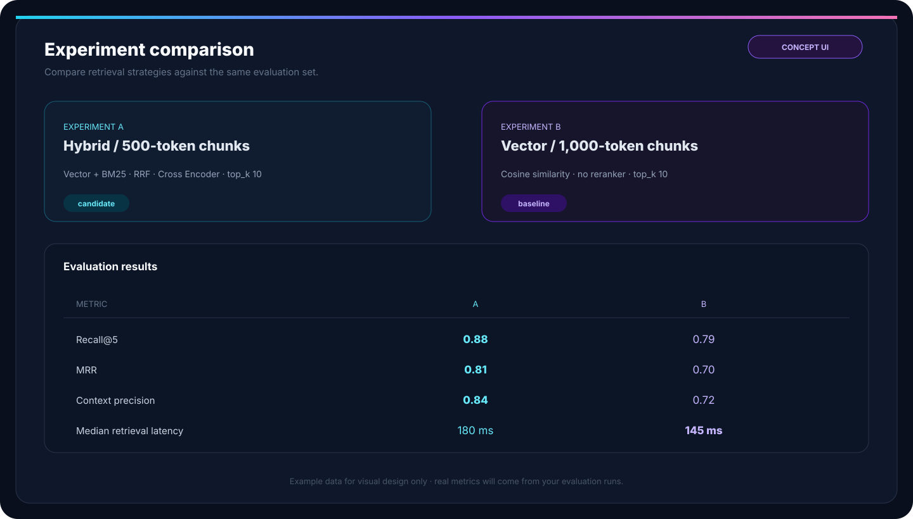

<p align="center">
  
</p>

<p align="center">
  <strong>An open-source workbench for inspecting, testing and improving RAG retrieval.</strong>
</p>

<p align="center">
  
  
  
  
</p>

> [!IMPORTANT]
> **Pre-alpha, not production ready.** Knowledge Bases, Documents, Chunk Inspector, Retrieval Lab and Trace History/Comparison are backed by live FastAPI/PostgreSQL data after local operator sign-in. Evaluation and RAG Answer screens still use **clearly labeled sample data**. The images below are concept illustrations, not verified screenshots of backend results.

[Quick start](#quick-start) · [Implemented today](#implemented-today) · [Architecture](docs/architecture.md) · [Roadmap](docs/roadmap.md) · [Development guide](docs/development.md) · [Benchmark CI](docs/quality-gate-ci.md)

## What Spurel does

Spurel helps RAG developers understand **which document chunks were retrieved, how they ranked, whether the answer was grounded, and whether a change improved retrieval quality**.

The backend supports document ingestion, persisted chunk versions, retrieval traces, and evaluation runs. The frontend exposes **live source, chunk, retrieval and saved-trace comparison**. Evaluation and RAG-answer metrics shown in their separate screens remain **illustrative**, not backend results.

## Quick start

**Requirements:** Docker with Compose v2, Python 3 and Make. You do not need to install Node or the Python backend packages on your host.

From the repository root:

```bash
make up       # Create .env safely, build, migrate, start and wait for healthy services
make status   # Check PostgreSQL-backed API, bearer authentication and frontend
make logs     # Follow container logs
make down     # Stop without deleting the local database or uploaded files
```

| Local service | URL or port | Status |
| --- | --- | --- |
| Next.js frontend | http://127.0.0.1:3000 | Live knowledge bases, documents and chunks after local operator login |
| FastAPI health | http://127.0.0.1:8000/health | Public |
| FastAPI business API | http://127.0.0.1:8000/knowledge-bases | Shared bearer token required |
| PostgreSQL + pgvector | 127.0.0.1:5432 | Local development only |

The initializer writes a strong random `SPUREL_API_TOKEN` to the ignored `.env` without displaying it. **Never commit that file or put the token into frontend/client-side code.** To try an authenticated endpoint from a trusted local shell:

```bash
set -a
source .env
set +a
curl -H "Authorization: Bearer $SPUREL_API_TOKEN" \
  http://127.0.0.1:8000/knowledge-bases
```

No OpenAI key is required to **start** the stack or manage knowledge bases. Document embedding and generated answers require provider credentials and configuration. See the [development guide](docs/development.md) for environment variables, tests, migrations, alternate ports and data safety.

## Interactive frontend (SP-09–SP-13)

The approved midnight-blue, cyan and violet design is implemented in Next.js as a responsive
application shell with keyboard command search (**⌘K / Ctrl+K**), theme switching, and eight
routes: Overview, Knowledge Bases, Retrieval Lab, Chunk Inspector, Evaluations,
Trace History, RAG Answers, and Settings. You can change retrieval mode and Top K,
compare illustrative benchmark runs, and explore sample RAG answers. **Only
Knowledge Bases, Documents and Chunk Inspector are currently API-backed.**

**SP-10 connects Knowledge Bases and Documents, SP-11 connects the
Chunk Inspector, SP-12 connects Retrieval Lab, and SP-13 connects
Trace History and Comparison**, all through the same signed, HTTP-only local
operator session.
Create collections, upload and process documents, then inspect the active chunks
and historic processing versions, including exact offsets, UUIDs and embedding
availability. The backend bearer token stays **only on the Next.js server**.
Evaluations and RAG Answers remain demos until SP-14–SP-15.

After `make up`, find your locally generated operator password in the ignored
`.env` by running `grep '^SPUREL_FRONTEND_OPERATOR_PASSWORD=' .env` from the repo root.
Open `http://localhost:3000/knowledge-bases` (or your configured frontend host port)
and sign in. Never share the password or session signing secret. Use `make up` after
pulling SP-10 to add the missing settings to **existing** `.env` files.

## Inspect real chunks (SP-11)

Once signed in, open [Chunk Inspector](http://localhost:3000/chunks) or select
**Inspect chunks** beside a document in Knowledge Bases. Select its active
index or a saved older version to view the actual stored excerpts, chunk UUIDs,
source character offsets, processing status and embedding-record counts.
Historical versions are **read-only and not used by normal retrieval**.
Pagination and text filtering operate on explicitly loaded pages, not the
entire database. An uploaded but unprocessed document correctly shows **no
active chunks**; indexing requires a configured embedding provider.

## Run real retrieval (SP-12)

After operator sign-in, open **[Retrieval Lab](http://localhost:3000/retrieval)**,
select a knowledge base, enter a query, choose **Keyword**, **Vector** or
**Hybrid**, and click **Run live retrieval**. The response contains real
ranked chunks, source offsets, raw scores, execution duration and the
persisted retrieval trace ID. **Inspect saved trace** reads the stored
snapshot and provider/model metadata; SP-13 adds full trace history
and comparison.

- **Keyword** uses PostgreSQL full-text search (`ts_rank_cd`, **not BM25**).
  It makes no query-time embedding-model call.
- **Vector** performs exact pgvector cosine retrieval and calls the configured
  embedding provider for the query.
- **Hybrid** runs both retrieval modes and fuses rankings with RRF. It supports
  `top_k`, `candidate_k` and `rrf_k`. Scores have **different scales**;
  the frontend displays the raw values, not invented percentages.

Both Vector and Hybrid may incur provider costs and require a configured
`OPENAI_API_KEY` plus compatible indexed embeddings. **No mode can return
evidence from a document until it has been successfully processed**.
Queries run only after you explicitly submit them, not as you type.

## Compare persisted retrieval traces (SP-13)

Sign in and open **[Trace History](http://localhost:3000/traces)**, or click
**Browse trace history** after a Retrieval Lab run. Choose a knowledge base,
inspect saved runs and optionally select two different traces as A and B.

SP-13 calls the existing read-only backend comparison service to show
the *actual* shared/unique chunk IDs, overlap ratio (Jaccard over the two
saved result sets), rank changes, raw scores and duration delta.
Negative rank delta means an improved numerical rank in B; it is
**not** proof of improved retrieval relevance or generated-answer quality.
Comparisons between **different queries** or **different retrieval modes**
are explicitly flagged. Undefined overlap when both runs have no results
is shown as **N/A**, not as a fabricated zero.

The UI loads history in bounded pages, filters **loaded** traces and
does not rerun queries, process documents or call embedding providers.
It requires the existing local operator login; the backend bearer token
remains server-side.

## Implemented today

| Capability | Implementation | Where |
| --- | --- | --- |
| Knowledge bases and documents | FastAPI CRUD subset: create/list knowledge bases; upload/list documents; text, Markdown and text-extractable PDF parsing | [Documents](backend/src/spurel/documents/) |
| Chunk inspection | Fixed-size **character** windows with overlap, persisted offsets and UUIDs; read-only version history | [Chunking](backend/src/spurel/infrastructure/chunking/fixed.py) |
| Embeddings | OpenAI embedding adapter; persisted pgvector embeddings keyed by provider/model/dimensions | [Embeddings](backend/src/spurel/embeddings/) |
| Retrieval | Exact pgvector cosine search; PostgreSQL full-text keyword scoring (`ts_rank_cd`, **not BM25**); hybrid Reciprocal Rank Fusion | [Retrieval](backend/src/spurel/retrieval/) |
| Inspectable retrieval | Saved retrieval traces, trace comparisons and graded retrieval metrics | [Retrieval API](backend/src/spurel/retrieval/api.py) |
| Evaluation | Labeled datasets, precision/recall@k, MRR, nDCG, coverage, persisted runs, comparisons, promoted baselines and regression gates | [Evaluation](backend/src/spurel/evaluation_datasets/) |
| Label consistency | Reject new judgments for inactive or foreign chunks; detect stale historical labels before live evaluations; judgment audit endpoint | [Judgment audit](backend/src/spurel/evaluation_datasets/judgment_integrity.py) |
| RAG answers | Hybrid retrieval plus OpenAI text generation, bounded source excerpts and model-requested source labels | [RAG](backend/src/spurel/rag/) |
| Reprocessing | Immutable chunk-set versions, stable UUIDs for unchanged chunks, staged embeddings, fenced retries and atomic activation | [Processing](backend/src/spurel/documents/processing.py) |
| Live frontend source management | Local operator login, live knowledge-base creation/list, document upload/list and indexing, server-only backend proxy | [Knowledge bases](frontend/components/live/knowledge-bases.tsx) |
| Live Chunk Inspector | Read-only active chunks, historical versions, persisted text, offsets, embedding counts, filtering and pagination | [Chunk Inspector](frontend/components/live/chunk-inspector.tsx) |
| Live Retrieval Lab | Keyword, vector and hybrid queries; actual raw ranked scores, source offsets, parameters, persisted trace inspection | [Retrieval Lab](frontend/components/live/retrieval-lab.tsx) |
| Live Trace History and Comparison | Newest-first saved retrievals, scoped snapshot inspection, overlap, rank movement, raw score and timing comparisons | [Traces](frontend/components/live/traces.tsx) |
| Local developer tools | Full-stack Docker Compose, Alembic, pytest/PostgreSQL integration checks, Ruff, frontend lint/types/tests/build | [Development](docs/development.md) |

**Security boundary:** A local operator password gates the Next.js source-management API. A
signed, HTTP-only session allows the Next.js server to call FastAPI with its separate
shared bearer token; no backend token is included in client code. This is **single-user
local access**, not per-user authorization, RBAC, or permission-aware multi-tenancy. Knowledge-base scoped queries are not user-specific tenant authorization. Do **not** expose it as a public multi-user service.

## Not implemented yet

The following are roadmap items, **not current capabilities**: live evaluation and RAG-answer frontend workflows, token-aware/structured chunking, OCR or scanned-PDF support, BM25, HNSW/ANN indexing, metadata retrieval filters, cross-encoder reranking, citation verification, additional hosted/local model adapters, multi-source connectors, experiment export, durable background ingestion and production-grade multi-user authorization.

For task scope and order, see the [maintained roadmap](docs/roadmap.md).

## API overview

All routes below except `GET /health` require `Authorization: Bearer <token>`.

| Workflow | Example endpoint |
| --- | --- |
| Create/list knowledge bases | `/knowledge-bases` |
| Upload/list/process documents | `/knowledge-bases/{knowledge_base_id}/documents` |
| Inspect active or historical chunks | `/knowledge-bases/{knowledge_base_id}/documents/{document_id}/chunks` and `.../versions` |
| Query vector, keyword or hybrid search | `/knowledge-bases/{knowledge_base_id}/retrieval/{mode}` (`vector`, `keyword` or `hybrid`) |
| Browse retrieval traces | `/knowledge-bases/{knowledge_base_id}/retrieval/traces` |
| Manage evaluation datasets and runs | `/knowledge-bases/{knowledge_base_id}/evaluation-datasets` |
| Audit stale evaluation labels | `/knowledge-bases/{knowledge_base_id}/evaluation-datasets/{dataset_id}/judgment-audit` |
| Generate a retrieved-context answer | `/knowledge-bases/{knowledge_base_id}/rag/answer` |

Set `SPUREL_ENABLE_DOCS=1` **only in a trusted local environment** to expose Swagger at `/docs`. Protected routes still require the bearer token; the docs and schema themselves are publicly readable on the bound server when enabled.

## Architecture at a glance

```text
Next.js live source, chunk and retrieval inspection
          |
          v
 FastAPI + shared bearer authentication
          |
          +-- Documents -> parse -> chunk-set versions -> staged embeddings -> activate
          +-- Retrieval -> exact vector / Postgres FTS -> RRF -> saved traces
          +-- RAG -> traced retrieval -> provider-backed answer + source excerpts
          +-- Evaluation -> labeled cases -> runs -> comparisons / baselines / gates
          |
          v
 PostgreSQL 17 + pgvector, local document blob storage
```

Backend code is organized into domain/application services, interfaces (ports), and SQLAlchemy/provider adapters. Ingestion currently runs synchronously in an HTTP request; it is **not** a durable job pipeline. See [architecture and design limitations](docs/architecture.md).

## UI vision (concepts only)

These images illustrate the planned interface. The repository now serves a responsive React workbench with **live source/chunk/retrieval/trace inspection** and sample-only evaluation/answer views. These images remain illustrative mockups; they are not screenshots of live Spurel backend results.

<p align="center">
  
</p>

<p align="center">
  
</p>

The future workbench will make source candidates, scoring, chunk boundaries, evaluation runs and experiments visually explorable. The backend primitives exist for several of these features, but their UI has not been implemented.

## Roadmap and contributing

The [roadmap](docs/roadmap.md) tracks **SP-01–SP-28** by phase. SP-09 built the frontend shell, SP-10 connected source management, SP-11 connected chunk inspection and SP-12 added live retrieval, and SP-13 connects saved trace comparison. SP-14–SP-15 will implement evaluation and RAG-answer workflows.

Spurel is being built in public. For substantial changes, open an issue first and follow the existing architecture and tests. Good contribution areas include retrieval strategies, parsers, evaluation methods, reliable ingestion, UI, and documentation.

Project principles: **retrieval first**, **inspectable by default**, **measure before tuning**, **provider boundaries**, **reproducible experiments**, and **simple before clever**.

---

<p align="center"><strong>Spurel</strong> — See what your RAG pipeline is really doing.</p>
